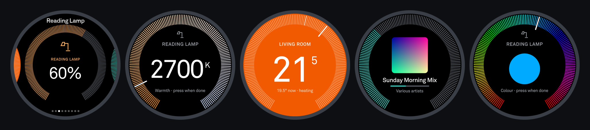

<p align="center">
  
</p>

<h1 align="center">Fledge for Home Assistant</h1>

<p align="center">
  <b>Home Assistant on your Nest thermostat's own screen.</b><br>
  Turn the ring to your lights, heating zones and speakers. Press to take control.
</p>

<p align="center">
  <a href="https://github.com/sysmoon14/fledge-homeassistant/releases"></a>
  <a href="https://github.com/sysmoon14/fledge-homeassistant/actions"></a>
  
</p>

<p align="center">
  
</p>

Walk up to the thermostat and it wakes to your devices, zoomed out around the
thermostat itself, each card's name above it. Turn to browse, press to open:

| Card | Press | Turn | Long press | Its menu |
|-|-|-|-|-|
| 💡 **Light** | its dimmer | brightness | on / off | on / off, **warmth** and **colour** dials where it has them, and a group's **each light** |
| 🔌 **Switch, fan** | on / off | | on / off | |
| 🌡️ **Other thermostat** | its target | the temperature, as the Nest sets its own | | its presets: eco, away… |
| 🔊 **Speaker** | its volume | the volume | play / pause | play / pause, previous, next; album art and progress on the card |
| 🔥 **Option (select)** | its options | through them | | e.g. the Nest's hot water boost |
| 🪟 **Blind, cover** | how open | the position | open / close | open, close |
| ✨ **Scene, script, button** | runs it | | | |
| 📷 **Camera** | a fresh picture | | | its latest still fills the card |
| 🔥 **The Nest itself** | the Nest as it always was | | | Back in its menu returns to the cards |

Everything is drawn on the thermostat at 60 frames a second, in the Nest's own
style, with its clicks. The Nest keeps running the heating throughout.

This is the Home Assistant half of **[Fledge](https://github.com/sysmoon14/fledge)**,
which roots the thermostat and runs it locally. It needs a Nest Learning
Thermostat (3rd generation) running Fledge, connected to Home Assistant over MQTT.

## Install

1. **Fledge on the thermostat**, with MQTT: it shows up in Home Assistant as a
   "Nest Thermostat" device. See [Fledge](https://github.com/sysmoon14/fledge#get-started).
2. **This integration:** in the Marketplace (or HACS), add
   `https://github.com/sysmoon14/fledge-homeassistant` as a custom repository of
   type Integration, download **Fledge**, and restart Home Assistant.
3. **Set it up:** Home Assistant offers the thermostat under Settings →
   Devices & services (or add Fledge there by hand). Pick your devices, in the
   order you want them, and what the thermostat wakes to.

Change them any time from **Fledge** in the sidebar (admins only): drag the
cards into the ring's order (the thermostat's own card too, from Fledge v0.5 on
the Nest; Settings stays last), rename one for the Nest or the thermostat
itself, choose one to wake straight to, and turn a ring on the page to see each
card drawn as the Nest draws it, in its Nest or Fledge look. The same tabs set
the wake and glance, try a notification, and show the thermostat's builds, its
update and a check for one. The integration's **Configure** still works too.
A light group makes a whole room one card. Removing the integration puts the
thermostat back as it was.

## Make it yours with automations

The integration adds a **Nest Thermostat cards** device, connected to the
thermostat's own, with:

| Entity | What it does |
|-|-|
| `select` **Wake to** | What the thermostat shows as it wakes: the device chooser, **Automatic** (the speaker that's playing, else after sunset a light that's on, else the chooser), the thermostat as the Nest always did, or any of your devices. |
| `switch` **Keep screen on** | Keeps the thermostat's display lit. |
| `button` **Wake screen** | Lights the display onto what it wakes to. |

In **Configure**, **A glance as someone comes near** makes the Nest, when it
lights up because you walked up (not a touch), show the time, the weather (from
a weather entity you pick) and what's on; a touch shows what it wakes to.

So the thermostat can show what matters right now, for example the speaker
while music plays, and the device chooser otherwise:

```yaml
automation:
  - alias: Nest shows the music while it plays
    triggers:
      - trigger: state
        entity_id: media_player.kitchen_speaker
    actions:
      - action: select.select_option
        target:
          entity_id: select.nest_thermostat_cards_wake_to
        data:
          option: "{{ 'Kitchen speaker' if is_state('media_player.kitchen_speaker', 'playing') else 'Device chooser' }}"
```

Or keep the screen on while you cook, light it when the doorbell rings, or wake
it to the lights at sunset.

## Notifications on the Nest

`fledge.notify` puts a message on the thermostat's screen, waking it with a
chime: an icon, a title and a message, or a camera's picture, taken there and
then, filling the round screen. Press to answer it, hold to dismiss it; either
fires a `fledge_notification` event with its tag, so an automation can act on
the answer. It dismisses itself after `timeout` seconds, and `fledge.dismiss`
takes it back.

**The doorbell:** someone rings, and the thermostat shows who's there.

```yaml
automation:
  - alias: Doorbell on the Nest
    triggers:
      - trigger: state
        entity_id: binary_sensor.front_door_ding
        to: "on"
    actions:
      - action: fledge.notify
        data:
          title: Someone's at the front door
          message: Front door
          camera: camera.front_door
          tag: doorbell
          timeout: 60
```

**An answer:** a press on the Nest locks the back door.

```yaml
automation:
  - alias: Back door left open
    triggers:
      - trigger: state
        entity_id: binary_sensor.back_door
        to: "on"
        for: "00:10:00"
    actions:
      - action: fledge.notify
        data:
          title: Back door open
          message: Press to lock it when it's shut.
          icon: mdi:door-open
          tag: back_door
      - wait_for_trigger:
          - trigger: event
            event_type: fledge_notification
            event_data: { tag: back_door, action: pressed }
        timeout: "00:02:00"
        continue_on_timeout: false
      - action: lock.lock
        target:
          entity_id: lock.back_door
```

## The Nest's schedules on your dashboards

Fledge brings two dashboard cards for the Nest's own weekly schedules, heating
and hot water. There's nothing to add under Resources: they load with the
integration.

```yaml
type: custom:fledge-heating-schedule
entity: climate.nest_thermostat
```

```yaml
type: custom:fledge-hot-water-schedule
entity: climate.nest_thermostat
```

Each shows the week, today and the time now marked. Tap a day or Edit schedule
to change it: a day at a time, with every changed day saved together. **Copy
to…** gives the day you're on to any others (Weekdays, Weekend, Every day, or
picked one by one) in a single write, with Undo for a few seconds after. On the
hot water card the pill pauses and resumes the schedule; on the heating card it
opens the thermostat.

The editor opens in the card's own dialog. To use your own popup instead, give
the card `edit: '#your_popup'` and put `custom:fledge-heating-schedule-editor`
(or `fledge-hot-water-schedule-editor`) with the same `entity` in that popup.

The cards write with `fledge.set_schedule`, which automations can use too. It
replaces the days it names and keeps the rest:

```yaml
action: fledge.set_schedule
data:
  entity_id: climate.nest_thermostat
  heating:
    sat: [{ time: "08:00", temp: 21 }, { time: "22:30", temp: 16 }]
    sun: [{ time: "08:00", temp: 21 }, { time: "22:30", temp: 16 }]
  hot_water:
    sat: [{ on: "07:00", off: "08:00" }]
```

Writing the heating schedule turns the Nest's Auto-Schedule off, as any edit of
its schedule does, and sets the temperature that applies now unless the Nest is
in Eco.

## Updates

This integration and the thermostat's software are released apart, and talk
only over MQTT:

- **This integration** updates from the Marketplace. When it does, it has the
  thermostat look for its own update straight away, as the two often come out
  together.
- **The thermostat** updates from its own update entity (Settings → Updates),
  signed, and rolls itself back if the new build doesn't come up.
- **If they don't match**, the thermostat says which version of the cards it
  understands, and a repair under Settings → Repairs asks you to update it.

## What the thermostat may do

Only to the devices chosen here, and only: switch a light, switch or fan on or
off; set a light's brightness, warmth or colour; set a thermostat's temperature;
set a media player's volume, and play or pause it; run a scene, script or
button; take a camera's picture. Anything else it asks for is refused and
logged. A notification's answer only fires an event, for your automations.

## Security

The thermostat and this integration talk over your MQTT broker, so whoever
can publish to it can do what the thermostat can: anything listed above, to
the devices you chose (a garage door among them, if you add one), and put
messages on its screen. Give the broker passwords (and TLS if you can), and if
it supports ACLs, let only Home Assistant publish to `nestlocal/+/set/#` and
only the thermostat's user publish to `nestlocal/+/ui/#`. A notification's
answer is only taken while that notification is showing.

## Development

```sh
uv venv --python 3.13 .venv && uv pip install -r requirements_test.txt
.venv/bin/pytest
```

Checks run on every push: the tests, Home Assistant's hassfest, and HACS validation.

## License

GPL-3.0, as [Fledge](https://github.com/sysmoon14/fledge). Fledge is not
affiliated with, endorsed or sponsored by Google LLC or Nest Labs. Nest and Nest
Learning Thermostat are trademarks of Google LLC.
